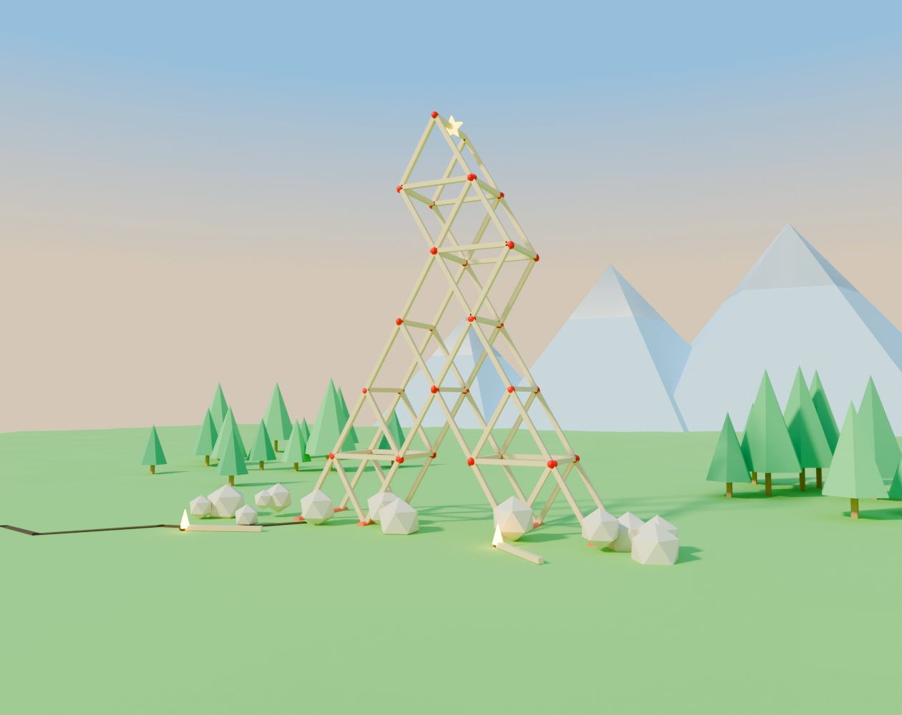

# 火柴建築師 Match Architect



你是一位火柴建築師：接下世界各地的委託，用最少的火柴搭出建築骨架，撐過 10 秒大地震。AI Browser Game Jam 5 參賽作品。

**線上玩：<https://brycekuo-proj.github.io/match-architect/play.html>**　｜　首頁：<https://brycekuo-proj.github.io/match-architect/>

免費、瀏覽器直接玩，手機和電腦都可以。`play.html` 是單一檔案、可離線。遊戲有繁體中文和英文，依瀏覽器語言自動切換，標題畫面也可以手動切換。

> **English:** *Match Architect* is a free browser game for AI Browser Game Jam 5. Take building jobs from around the world, frame them out of fixed-length matchsticks, and survive a 10-second earthquake: fewer matches, more stars. If a glue joint snaps, fire runs through the matches and the whole thing comes down; pass, and a cute 3D model of the real landmark spins on a turntable. The game switches to English for non-Chinese browsers (there's a language button on the title screen). itch.io page text, cover and screenshots: [`docs/itch/`](docs/itch/ITCH_PAGE.md).

## 玩法
- 每關是一張**委託單**：工程名稱、地點、震度、任務要求和達成獎勵。
- 第一、二關有互動教學：手指示範要從哪裡拖到哪裡、虛線標出火柴位置，放錯會提示按「復原」，可以跳過。
- 從紅色錨點或火柴端點按住拖曳，放開就放下一支固定長度的火柴；端點會自動吸附。
- 在火柴中段按住拖曳，可以把新火柴黏上去做斜撐。
- 建造時沒有重力；按「開始地震」後地面左右搖晃 10 秒。
- 膠點一斷，火會沿著火柴燒過去，燒到的膠點融掉，整棟倒塌燒成黑炭。
- 所有星星都撐住、沒有膠點斷掉就過關，不規定一定要用幾支。火柴用越少，星星越多（三星目標以內 ★★★、1.25 倍以內 ★★）。
- 縮放：手機兩指捏合，或按畫面右邊的 ＋／－（⤢ 回到整棟建築）；電腦可用滑鼠滾輪、觸控板捏合或鍵盤 + − 0。
- 單指拖空白處移動畫面。

## 完工模型
過關時會先看到這棟建築的 Q 版低多邊形模型在轉台上旋轉，可以用手指轉。13 個模型都是用 Blender 的 Python 腳本做的（`blender/make_landmarks.py`），貼圖也是腳本畫的，仿原建築的石塊、鐵架、玻璃帷幕和拱廊。

## 金幣
- 每關的配額是三星目標的 2 倍。每支火柴成本 1 金幣，按下「開始地震」時付款；錢不夠就不能再放火柴。
- 驗收合格後，配額裡沒用完的火柴每支換 2 金幣。例：艾菲爾鐵塔配額 40 支，用 20 支 → 成本 −20、酬勞 +40。
- 一開始有 30 金幣；沒撐過地震，那次的火柴錢就燒掉了。金幣低於 10 時會補到 10。
- 金幣會一直累積，排行榜也有金幣總榜。

## 商店與防震道具
商店只能從標題畫面進去，遊戲進行中不能買東西。搭建時從畫面左邊的**道具框**使用買好的道具（點一下使用，再點一下取消），框上的數字是庫存。

道具都是**一次性**的：按下「開始地震」時用掉，要再用就要重新買；地震中途按停止會退還。用了物理道具（示範券、檢測儀除外）的成績不上排行榜，星星和金幣照算。道具的效果都參考真實的耐震工程：

| 道具 | 價格 | 用法與效果 |
|---|---|---|
| 阻尼球 | 1200 | 掛在一個接點下（約 2/3 高度最好），仿台北 101 的調諧質量阻尼器，抵掉附近火柴的晃動 |
| 鉛心橡膠隔震墊 | 1000 | 開關式，整棟建築放在會滑動的隔震平台上；高樓受力大約減半 |
| 彈簧避震器 | 300／支 | 點兩個接點，中間裝一支不會斷的彈簧油壓斜撐；一棟最多 6 支 |
| 碳纖維包覆 | 200（5 份） | 點火柴包起來：重量 ×0.6、接點強度 ×1.8 |
| 高韌性鋼骨 | 150 | 開關式，接點受力過頭時先彎曲，到 1.7 倍才斷 |
| 結構檢測儀 | 500 | 先試跑一次地震，標出最先斷的接點和每個接點的受力（每檢測一次用 1 個） |
| 工頭示範券 | 100 | 顯示這關參考解的虛線，用過後這關永久有效 |

商店也賣外觀：火柴造型（竹筷 300、糖果棒 400、夜光 600、金火柴 1000）和場景（沙漠 200、雪地 400、夜晚 600）。過關的建築模型收在標題畫面的「展示櫃」。

## 廣告（App 版）
網頁版、itch.io 版和 jam 版都**沒有廣告**。廣告只在之後的 App 版（Capacitor + AdMob）出現，規則寫在 `src/ads.js`：
- 獎勵廣告（玩家自己選）：過關後看廣告再領一次酬勞、沒過關看廣告退回燒掉的火柴錢、每日禮物 30 → 60 金幣、商店裡看廣告領 20 金幣（每天 5 次）或示範券（每天 3 次）。
- 插頁廣告：只在驗收單按「下一張委託」時出現；前 3 關不出現；至少隔 3 次過關、3 分鐘；剛看過獎勵廣告不出現。
- 移除廣告：一次購買 US$2.99，只移除插頁廣告，獎勵廣告照樣可以用。
- 想先看流程：網址加 `?ads=mock` 會用假廣告（會記住，`?ads=off` 關掉）。
- App 端怎麼接 AdMob 和內購：[docs/APP_ADS.md](docs/APP_ADS.md)。

## 關卡
目前 13 關（3 個教學關＋10 座世界名建築，震度 3 → 7）。50 關企劃見 [docs/LEVEL_PLAN.md](docs/LEVEL_PLAN.md)。

## 排行榜
`dist/match-architect.html` 是 Claude 分享連結版，使用 Claude artifact 內建的共用資料庫，比每關誰用的火柴最少，以及金幣總榜。GitHub Pages 上的 `play.html` 沒有排行榜，其他功能相同。

## 技術
- 物理：[Planck.js](https://github.com/piqnt/planck.js)（2D，火柴是剛體、膠點是有摩擦的鉸接，受力超過門檻就斷）
- 畫面：[Three.js](https://threejs.org/) 即時 3D；地震開始時建築展開成有前後兩面的立體塔
- 卡通描邊：深度圖找出輪廓，在物體外側畫粗墨線（`src/outline.js`），遊戲畫面和完工模型都有
- 火柴模型、13 個 Q 版建築模型與封面：Blender（`blender/`）
- 音效與音樂：Web Audio 即時合成，沒有音檔

## 開發
```bash
npm install
npm run build   # 產生 dist/match-architect.html、dist/itch/index.html，並複製成根目錄的 play.html
cd dist/itch && zip ../match-architect-itch.zip index.html   # itch.io 上傳用的 zip
npm test        # 每關參考解必須撐過該關震度；太細、太窄的錯誤解必須倒；倒下的建築必須燒起來；每種道具都要真的有效
python3 test/zoom.py   # 縮放按鈕、雙指捏合、滾輪（需要 Playwright）
python3 test/items.py  # 道具：購買、道具框、放置、檢測、消耗與退還
python3 test/ads.py    # 廣告（假廣告模式）與移除廣告
```

| 檔案 | 內容 |
|---|---|
| `index.html` | GitHub Pages 首頁（遊戲介紹） |
| `play.html` | 遊戲本體（單一檔案、可離線；也可以打包上傳 itch.io） |
| `src/sim.js` | 關卡資料、建造規則、物理模擬 |
| `src/designs.js` | 每關參考解（三星目標） |
| `src/render3d.js` | Three.js 畫面 |
| `src/main.js` | 操作、流程、介面 |
| `src/turntable.js` | 過關時旋轉的 Q 版建築模型 |
| `src/outline.js` | 卡通粗描邊 |
| `src/i18n.js` | 中英文介面文字 |
| `src/coach.js` | 第一、二關的互動教學、工頭示範虛線、結構檢測結果 |
| `src/shop.js` | 商店品項、價格與庫存 |
| `src/icons.js` | 道具圖示 |
| `src/ads.js` | 廣告與移除廣告購買（假廣告／AdMob） |
| `src/leaderboard.js` | 排行榜（可換成其他後端） |
| `src/audio.js` | 合成音效與音樂 |
| `src/template.html` | 遊戲頁面與樣式 |
| `blender/` | 火柴、Q 版建築模型與封面的 Blender 腳本 |
| `assets/landmarks/` | 13 個 Q 版建築模型（GLB，建置時嵌入遊戲） |
| `docs/LEVEL_PLAN.md` | 50 關企劃 |
| `docs/APP_ADS.md` | App 版接 AdMob 與移除廣告內購 |
| `docs/itch/` | itch.io 報名素材：英文頁面文字、封面、截圖 |

調整手感：`src/sim.js` 的 `PARAMS.breakForce`（膠點強度）、`SHINDO`（各震度的振幅與頻率）、每關的 `shindo` 與 `par`。改完跑 `npm test`。
